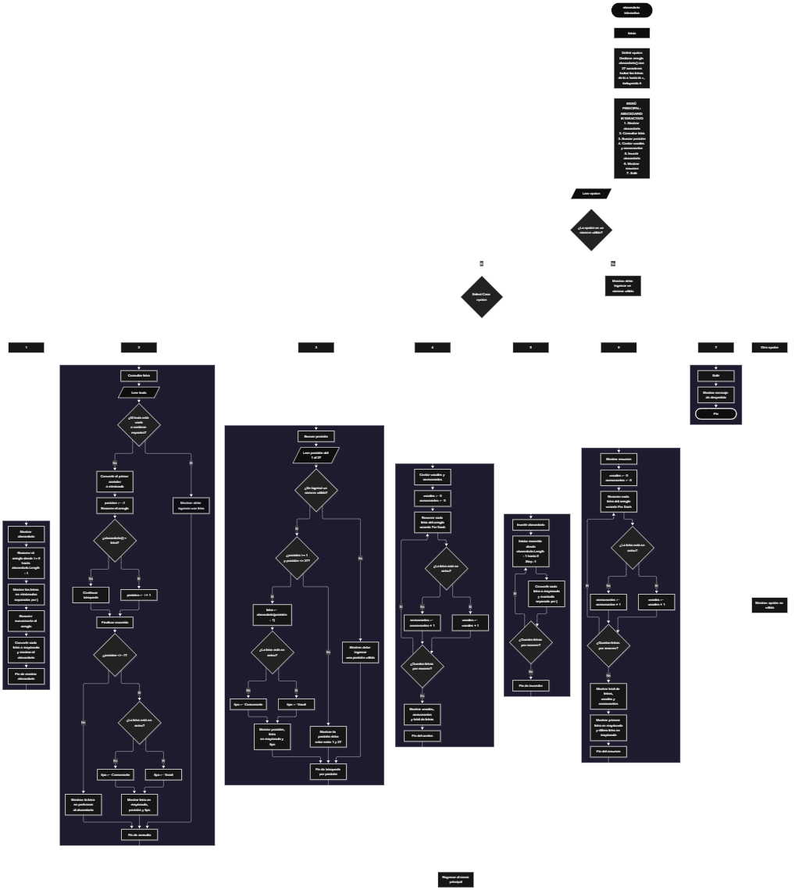

Este proyecto, llamado <b>abecedario interactivo</b>, fue desarrollado en <b>visual basic .net</b> como un ejercicio práctico para fortalecer la lógica de programación mediante la creación de un sistema interactivo para consultar y explorar las letras del abecedario español desde la consola. El programa cuenta con un menú principal de siete opciones que permite <b>mostrar el abecedario, consultar letras, buscar posiciones, contar vocales y consonantes, invertir el abecedario y mostrar un resumen</b> de sus elementos. Para almacenar las letras se utiliza un arreglo de tipo <b>char</b> con una capacidad de <b>27 caracteres</b>, incluyendo la letra ñ. Durante su desarrollo se aplicaron conceptos fundamentales de programación, como variables, arreglos, estructuras condicionales, ciclos repetitivos y estructuras de selección, además de procesos para recorrer, buscar, clasificar y transformar caracteres. Este proyecto permite poner en práctica los conocimientos adquiridos en visual basic .net y sirve como base para desarrollar aplicaciones interactivas más completas utilizando otros lenguajes y tecnologías.

<h2 align="center">⚙️ Funcionamiento del menú principal</h2>

### 📋 Mostrar abecedario

La opción <b>1) mostrar abecedario</b> permite visualizar todas las letras almacenadas en el arreglo <b>abecedario</b>. Primero, el programa utiliza un ciclo <b>for</b> para recorrer las posiciones del arreglo desde <b>0</b> hasta <b>abecedario.length - 1</b>, mostrando cada letra en minúscula y separándolas mediante el símbolo <b>|</b>. Después, realiza un segundo recorrido utilizando nuevamente un ciclo <b>for</b>, pero esta vez convierte cada carácter a mayúscula mediante la instrucción <b>char.toupper()</b>. De esta manera, presenta el abecedario en sus dos representaciones: minúsculas y mayúsculas. Esta función permite visualizar de forma organizada las 27 letras que componen el abecedario español.

### 🔎 Consultar letra

La opción <b>2) consultar letra</b> permite identificar una letra dentro del abecedario y conocer su posición y clasificación. Primero, el programa solicita al usuario que ingrese una letra mediante <b>console.readline()</b> y comprueba que el texto no esté vacío utilizando <b>string.isnullorwhitespace()</b>. Si existe una entrada, convierte el primer carácter ingresado a minúscula mediante <b>char.tolower()</b> y lo almacena en la variable <b>letra</b>. Después, inicializa la variable <b>posicion</b> con el valor <b>-1</b> y utiliza un ciclo <b>for</b> para recorrer el arreglo <b>abecedario</b>, comparando cada elemento con la letra introducida. Cuando encuentra una coincidencia, almacena su posición real sumando uno al índice del arreglo y finaliza el recorrido mediante <b>exit for</b>. Si la letra pertenece al abecedario, utiliza la condición <b>"aeiou".contains(letra)</b> para determinar si es vocal o consonante. Finalmente, muestra la letra en mayúscula, su posición y su tipo. Si no encuentra coincidencias, presenta el mensaje <b>"la letra no pertenece al abecedario."</b>. También comprueba que el usuario haya ingresado algún carácter antes de realizar la consulta.

### 🔢 Buscar posición

La opción <b>3) buscar posición</b> permite consultar una letra mediante el número de su ubicación dentro del abecedario. Primero, solicita al usuario una posición comprendida entre <b>1 y 27</b> y utiliza <b>integer.tryparse()</b> para comprobar que el valor ingresado sea numérico. Si la conversión es correcta, verifica que la posición esté dentro del rango permitido mediante la condición <b>posicion &gt;= 1 andalso posicion &lt;= abecedario.length</b>. Cuando la posición es válida, accede al elemento correspondiente del arreglo mediante <b>abecedario[posicion - 1]</b>, debido a que los índices de los arreglos comienzan en cero. Después, utiliza la condición <b>"aeiou".contains(letra)</b> para identificar si el carácter es vocal o consonante. Finalmente, muestra la posición seleccionada, la letra en mayúscula y su clasificación. Si el número está fuera del rango permitido o no es válido, presenta el mensaje correspondiente para informar al usuario.

### 📊 Contar vocales y consonantes

La opción <b>4) contar vocales y consonantes</b> permite conocer cuántas vocales y consonantes contiene el abecedario. Primero, declara e inicializa las variables <b>vocales</b> y <b>consonantes</b> con el valor <b>0</b>. Después, utiliza un ciclo <b>for each</b> para recorrer todos los caracteres almacenados en el arreglo <b>abecedario</b>. Durante cada repetición, comprueba si la letra actual pertenece al conjunto de vocales mediante la condición <b>"aeiou".contains(letra)</b>. Si la condición se cumple, incrementa la variable <b>vocales</b> en uno; de lo contrario, incrementa la variable <b>consonantes</b>. Al finalizar el recorrido, muestra la cantidad total de vocales, consonantes y letras almacenadas en el arreglo mediante <b>abecedario.length</b>. Esta función permite identificar y contabilizar los diferentes tipos de letras que componen el abecedario.

### 🔄 Invertir abecedario

La opción <b>5) invertir abecedario</b> permite mostrar las letras en orden inverso, comenzando desde la última hasta llegar a la primera. Para realizar esta operación, utiliza un ciclo <b>for</b> que inicia en <b>abecedario.length - 1</b> y termina en la posición <b>0</b>, utilizando la instrucción <b>step -1</b> para disminuir el contador en cada repetición. Durante el recorrido, accede a cada carácter del arreglo y lo convierte a mayúscula mediante <b>char.toupper()</b>. Además, utiliza una condición <b>if</b> para colocar el separador <b>|</b> entre las letras sin agregarlo después del último elemento mostrado. Finalmente, presenta el abecedario completo en orden inverso. Esta operación permite comprender cómo recorrer un arreglo desde su última posición hasta la primera sin modificar los datos originales.

### 📄 Mostrar resumen

La opción <b>6) mostrar resumen</b> permite presentar una descripción general del contenido del arreglo <b>abecedario</b>. Primero, declara e inicializa las variables <b>vocales</b> y <b>consonantes</b> con el valor <b>0</b>. Después, utiliza un ciclo <b>for each</b> para recorrer todas las letras y clasificarlas mediante la condición <b>"aeiou".contains(letra)</b>, incrementando el contador correspondiente según el resultado. Una vez finalizado el recorrido, muestra el total de letras almacenadas mediante <b>abecedario.length</b>, la cantidad de vocales, la cantidad de consonantes, la primera letra y la última letra del arreglo. Para mostrar estas dos últimas letras en mayúscula, utiliza <b>char.toupper(abecedario(0))</b> y <b>char.toupper(abecedario(abecedario.length - 1))</b>. De esta manera, proporciona un resumen organizado de las principales características del abecedario.

### 🚪 Salir del menú principal

La opción <b>7) salir</b> está destinada a finalizar la ejecución del programa y muestra el mensaje <b>"gracias por utilizar abecedario interactivo."</b>. El menú principal se encuentra dentro de una estructura repetitiva <b>do while</b>, que mantiene el programa en funcionamiento mientras el usuario selecciona diferentes operaciones. Al finalizar cada repetición, el programa comprueba la condición <b>opcion &lt;&gt; 7</b>, permitiendo que el ciclo termine cuando se selecciona la opción correspondiente a salir. De esta manera, el usuario puede utilizar todas las funcionalidades disponibles y finalizar el programa cuando lo desee.

<h2 align="center">🧠 Temas aplicados en el proyecto</h2>

### 📦 Variables

En este proyecto se utilizan variables para almacenar la opción seleccionada en el menú, guardar la letra ingresada por el usuario, controlar las posiciones del arreglo, identificar el tipo de letra y contabilizar las vocales y consonantes. Cada variable cumple una función específica dentro de las operaciones del programa y permite realizar las consultas, búsquedas, recorridos y clasificaciones de los caracteres almacenados.

🔢 **Opcion:** Almacena la opción seleccionada por el usuario en el menú principal.

📝 **Texto:** Almacena la cadena de caracteres ingresada por el usuario durante la consulta de una letra.

🔤 **Letra:** Almacena el carácter que se desea consultar, buscar o clasificar.

🔎 **Posicion:** Almacena la posición de una letra dentro del abecedario o la posición introducida por el usuario.

📊 **Vocales:** Almacena la cantidad de vocales identificadas durante el recorrido del arreglo.

📈 **Consonantes:** Almacena la cantidad de consonantes identificadas durante el recorrido del arreglo.

🏷️ **Tipo:** Almacena la clasificación de una letra, indicando si corresponde a una vocal o consonante.

🔄 **I:** Funciona como contador en los ciclos <b>for</b> y permite recorrer las posiciones del arreglo.

### 🗃️ Arreglos

En este proyecto se utiliza un arreglo de tipo <b>char</b> para almacenar las letras que componen el abecedario español. Este arreglo contiene <b>27 caracteres</b>, organizados desde la letra <b>a</b> hasta la letra <b>z</b>, incluyendo la letra <b>ñ</b> en su posición correspondiente. Cada elemento se encuentra identificado mediante un índice que comienza en <b>0</b> y termina en <b>26</b>. Esta organización permite acceder directamente a una letra mediante su posición, recorrer todos sus elementos, buscar caracteres específicos y mostrar el contenido en diferentes órdenes.

🔤 **Abecedario():** Almacena las 27 letras del abecedario español mediante caracteres de tipo <b>char</b>.

### 🔀 Estructuras condicionales

En este proyecto se utilizan las estructuras <b>if</b> y <b>else</b> para comprobar diferentes condiciones durante la ejecución del programa. Estas estructuras permiten validar que el usuario ingrese una opción numérica, comprobar que no deje vacía la consulta de una letra, determinar si un carácter pertenece al abecedario, verificar que una posición esté dentro del rango permitido y clasificar cada letra como vocal o consonante. También permiten controlar la presentación de los separadores durante los recorridos del arreglo. Estas condiciones hacen posible que el programa responda de manera diferente según los datos ingresados y los resultados obtenidos durante cada operación.

### 🔄 Estructuras repetitivas

En este proyecto se utilizan las estructuras repetitivas <b>do while</b>, <b>for</b> y <b>for each</b>. El ciclo <b>do while</b> mantiene activo el menú principal y permite ejecutar diferentes operaciones hasta que el usuario selecciona la opción de salida. Los ciclos <b>for</b> permiten recorrer el arreglo mediante sus índices para mostrar el abecedario, consultar letras, buscar posiciones e invertir el orden de los caracteres. También se utiliza la instrucción <b>step -1</b> para realizar recorridos descendentes. Por otro lado, los ciclos <b>for each</b> permiten recorrer directamente todos los caracteres almacenados para contar y clasificar las vocales y consonantes sin necesidad de trabajar directamente con los índices del arreglo.

### 🎯 Estructura según

El programa utiliza la estructura de selección <b>select case</b> para evaluar el valor almacenado en la variable <b>opcion</b> y ejecutar el bloque de instrucciones correspondiente. Cada caso representa una operación específica del sistema: <b>mostrar abecedario, consultar letra, buscar posición, contar vocales y consonantes, invertir abecedario, mostrar resumen o salir</b>. También se utiliza el bloque <b>case else</b> para mostrar el mensaje <b>"opción no válida."</b> cuando el usuario introduce un número que no corresponde a ninguna de las opciones definidas en el menú. Esta estructura permite organizar las funcionalidades del programa de manera clara y ordenada.

### 🔢 Inicialización y dimensionamiento del arreglo

El programa utiliza la declaración <b>dim abecedario() as char</b> para definir un arreglo destinado a almacenar caracteres. Posteriormente, inicializa sus elementos directamente mediante una lista de valores de tipo <b>char</b>, utilizando el sufijo <b>c</b> para representar cada carácter individual. Al proporcionar los 27 elementos durante su inicialización, el arreglo establece automáticamente su capacidad y permite acceder a sus posiciones desde el índice <b>0</b> hasta el <b>26</b>. Además, utiliza la propiedad <b>abecedario.length</b> para obtener la cantidad total de elementos y facilitar los recorridos, las búsquedas y las comprobaciones de límites.

### 🔄 Recorrido y búsqueda de elementos

El programa utiliza diferentes ciclos para recorrer y localizar los caracteres almacenados en el arreglo <b>abecedario</b>. Para consultar una letra, emplea un ciclo <b>for</b> que compara el carácter introducido con cada elemento del arreglo hasta encontrar una coincidencia. Para mostrar el abecedario, utiliza recorridos ascendentes mediante sus índices, mientras que para invertirlo realiza un recorrido descendente utilizando <b>step -1</b>. También utiliza <b>for each</b> para procesar directamente cada carácter durante el conteo de vocales y consonantes. Estos procedimientos permiten acceder, buscar, mostrar y clasificar los elementos del arreglo de manera organizada sin modificar su contenido original.

<h2 align="center">Operaciones de consulta y procesamiento del abecedario</h2>

Las operaciones implementadas en este proyecto permiten consultar y procesar los caracteres almacenados en el arreglo <b>abecedario</b>. La operación de <b>consulta</b> permite identificar una letra y conocer su posición y clasificación; la operación de <b>búsqueda</b> permite localizar una letra mediante su posición numérica; la operación de <b>recorrido</b> permite mostrar todos los caracteres en orden normal o inverso; y la operación de <b>clasificación y conteo</b> permite identificar las vocales y consonantes presentes en el abecedario. Finalmente, la operación de <b>resumen</b> reúne los resultados principales para presentar una descripción general del contenido del arreglo. Todas estas funcionalidades utilizan variables, arreglos, estructuras condicionales y ciclos para procesar la información durante la ejecución del programa.

<h2 align="center">Diagrama de flujo del proyecto</h2>

<h2 align="center">🛡️ Validaciones del programa</h2>

### 🔢 Entrada numérica del menú

Esta validación se utiliza cuando el usuario selecciona una opción del menú principal. El programa emplea <b>integer.tryparse(console.readline(), opcion)</b> para comprobar que el dato ingresado pueda convertirse correctamente en un número entero. Si la conversión falla, muestra el mensaje <b>"debe ingresar un numero valido."</b> y utiliza <b>continue do</b> para regresar al inicio del menú sin ejecutar ninguna operación. Esta comprobación evita que el programa procese entradas que no correspondan a números válidos.

### 🔤 Entrada vacía al consultar una letra

Esta validación se utiliza en la opción <b>consultar letra</b>. El programa comprueba si el usuario no ha ingresado ningún carácter o si solamente ha introducido espacios en blanco mediante <b>string.isnullorwhitespace(texto)</b>. Si la condición se cumple, muestra el mensaje <b>"debe ingresar una letra."</b> y evita continuar con el proceso de búsqueda. Si existe una entrada válida, obtiene el primer carácter del texto mediante <b>texto(0)</b> para realizar la consulta correspondiente.

### ❌ Letra no perteneciente al abecedario

Esta validación se utiliza durante la consulta de letras. El programa inicializa la variable <b>posicion</b> con el valor <b>-1</b> y recorre el arreglo <b>abecedario</b> para comparar sus elementos con el carácter introducido. Cuando encuentra una coincidencia, actualiza la posición correspondiente y finaliza el recorrido. Si al terminar la búsqueda la variable <b>posicion</b> continúa siendo igual a <b>-1</b>, significa que no encontró la letra solicitada y muestra el mensaje <b>"la letra no pertenece al abecedario."</b>. Esta comprobación permite identificar caracteres que no forman parte de los elementos almacenados.

### 🔢 Posición fuera del rango permitido

Esta validación se utiliza en la opción <b>buscar posición</b>. Primero, el programa comprueba que el valor introducido pueda convertirse en un número entero mediante <b>integer.tryparse()</b>. Después, verifica que la posición esté comprendida entre <b>1 y 27</b>, utilizando la condición <b>posicion &gt;= 1 andalso posicion &lt;= abecedario.length</b>. Si el número está fuera del rango, muestra el mensaje <b>"la posicion debe estar entre 1 y 27."</b>. Si el dato no es numérico, presenta el mensaje <b>"debe ingresar una posicion valida."</b>. Estas comprobaciones evitan acceder a posiciones que no existen dentro del arreglo.

### ⚠️ Opción inválida

La estructura <b>select case</b> incluye el bloque <b>case else</b>, que muestra el mensaje <b>"opcion no valida."</b> cuando el usuario introduce un número que no corresponde a ninguna de las opciones definidas en el menú principal. Esta validación permite controlar las selecciones incorrectas y mantener el funcionamiento del programa sin ejecutar operaciones que no están contempladas.

### 🔄 Clasificación de vocales y consonantes

Esta comprobación se utiliza en las opciones <b>consultar letra, buscar posición, contar vocales y consonantes y mostrar resumen</b>. El programa utiliza la expresión <b>"aeiou".contains(letra)</b> para determinar si el carácter actual corresponde a una de las cinco vocales. Si encuentra una coincidencia, lo clasifica como <b>vocal</b>; de lo contrario, lo clasifica como <b>consonante</b>. Esta condición permite identificar correctamente las letras del abecedario, incluyendo la letra <b>ñ</b> como consonante.

<h2 align="center">🎯 Objetivo del proyecto</h2>

El objetivo principal de este proyecto es fortalecer la <b>lógica de programación</b> mediante el desarrollo de un sistema interactivo para consultar y procesar las letras del abecedario español en <b>visual basic .net</b>. A través de su construcción se busca aplicar los conocimientos adquiridos sobre variables, arreglos, estructuras condicionales, ciclos repetitivos y estructuras de selección, integrándolos para resolver diferentes operaciones de manera organizada. Además, el proyecto permite comprender cómo almacenar, recorrer, buscar, clasificar y mostrar información utilizando arreglos y estructuras de control en una aplicación de consola, estableciendo una base para desarrollar programas más completos con otros lenguajes y tecnologías.

